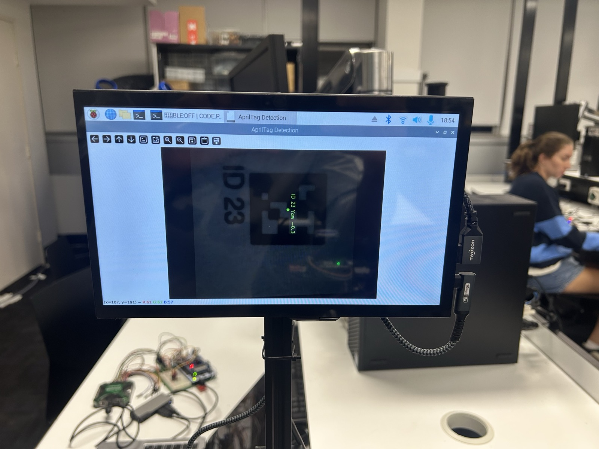

# RCM controller firmware

Embedded C and FreeRTOS controller firmware for a remote-controlled microscope (RCM), developed for CSSE3010 on the STM32 Nucleo-F429ZI. The application handles user input, constructs command packets, applies Hamming encoding, and sends commands over an nRF24L01+ radio link.

## Hardware demonstration



A photograph from the original laboratory demonstration shows the microscope camera view with AprilTag ID 23 detected. This illustrates the wider RCM system used with the controller. The camera viewer and AprilTag detection software are external to the firmware in this repository.

### Radio packet output

The receiver log photographed during the demonstration shows zoom commands arriving with type `0x26` and payloads `ZOOM030`, `ZOOM020`, and `ZOOM010`. A shortened transcription is shown below; the sender identifier is omitted for privacy.

```text
TYPE:    0x26 - ZOOM
SENDER:  [omitted]
PAYLOAD: ZOOM030
Received: [32 bytes]

TYPE:    0x26 - ZOOM
SENDER:  [omitted]
PAYLOAD: ZOOM020
Received: [32 bytes]

TYPE:    0x26 - ZOOM
SENDER:  [omitted]
PAYLOAD: ZOOM010
Received: [32 bytes]
```

This output provides evidence of command reception and payload decoding during the original demonstration. It does not by itself measure movement accuracy or radio reliability. The firmware constructs a 16-byte packet and Hamming-encodes it into 32 bytes for transmission.

The photographs and log predate the portfolio cleanup. The current source uses a generic sender ID, which must be configured for the target receiver. The photographed rig is labelled with RF channel 56; the supplied `myconfig.h` currently selects channel 52, so the radio channel and destination address must also be matched to the hardware being used.


## Contents

- `repo/pf/`: final application, FreeRTOS configuration, and build files.
- `repo/mylib/`: the 15 C modules referenced by the final application's build, their headers, and `myconfig.h`.
- `sourcelib/components/` and `sourcelib/tools/`: supplied board support, STM32 HAL, FreeRTOS, peripheral libraries, and build/programming tools. These are third-party/course support code, not original project contributions. Existing notices are retained.

The application uses an `rcm` namespace for project filenames and symbols. Earlier practicals (`s1`–`s4`), unused pushbutton and radio module pairs, teaching examples/templates, Git history, and generated build files are excluded.

## Build layout

Keep `repo/` and `sourcelib/` together when moving this directory. The original Makefiles rely on their relative locations.

With the ARM embedded GCC toolchain and GNU Make available, from this directory:

```sh
export SOURCELIB_ROOT="$PWD/sourcelib"
cd repo/pf
make
```

Hardware execution requires the board and the project's connected peripherals. The renamed firmware has been compiled and linked with ARM GNU Toolchain 14.3.Rel1. The current portfolio version has not been retested on hardware; the demonstration above documents the earlier laboratory setup.

## Supporting library provenance

Source: ssh://git@github.com/uqembeddedsys/sourcelib.git

Local dependency revision at extraction: `a657ae0ddb49f7e7d5a36ba9916b2512823a742c`.

The copied support tree includes components for other boards to preserve the supplied library structure. Examples and templates are omitted. Review the course publication rules and the supplied components' licence terms before publishing; no new blanket licence is applied here.

## Sender configuration

`repo/mylib/myconfig.h` defines a generic example sender ID (`00 00 00 01`). Configure `RCM_SENDER_ID_0` through `RCM_SENDER_ID_3` to match an ID accepted by the receiver before hardware use.
